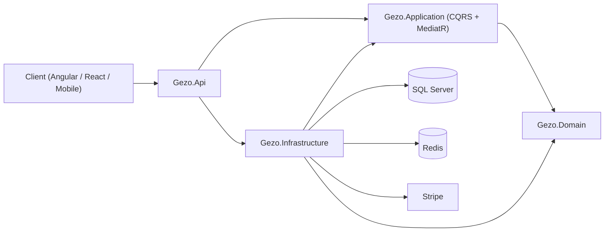

<h1 align="center">Hi, I'm Kareem Mahmoud Ahmed 👋</h1>

<h3 align="center">Backend Developer | C# • ASP.NET Core • SQL Server</h3>

I design and build <b>secure, scalable Web APIs</b> using <b>Clean Architecture</b>, <b>CQRS</b> and <b>Domain-Driven Design</b>. 
From authentication and payments to caching and inventory control, I focus on backend systems that are production-ready.

  
  
  

---

## 🚀 About Me

- 🎓 B.Sc. in Computer Science, Nahda University (Beni Suef), GPA 3.6, Very Good with Honors
- 💻 ITI 9-Month Professional Training Program, 2025 to present
- 🏆 Full Stack .NET graduate, Digital Egypt Pioneers Initiative (DEPI)
- 🥇 ECPC Finalist
- 🧩 Freelance developer on Mostaql, delivering backend systems and e-commerce platforms
- 🌱 Passionate about clean, maintainable code, SOLID principles and continuous learning
- 📍 Egypt | Military Status: Exempted

---

## 🛠️ Backend Tech Stack

**Languages & Frameworks**

**Databases & Caching**

**Security, Payments & Docs**

**Tools & Cloud**

**Architecture & Practices**

`Clean Architecture` • `CQRS` • `DDD` • `MediatR` • `Repository & Unit of Work` • `Specification Pattern` • `FluentValidation` • `AutoMapper` • `SOLID` • `UML`

**Frontend (when needed):** HTML • CSS • JavaScript • React • Angular • Bootstrap • Tailwind CSS

---

## 💼 Featured Projects

### 🛒 [Gezo Store: Enterprise E-Commerce Backend API](https://github.com/ElGazery/gezo-store-backend)

A production-grade E-Commerce Web API built with **.NET 10**, following **Clean Architecture**, **CQRS** and **DDD**.

- 🔐 **Auth:** ASP.NET Core Identity, JWT, refresh token rotation, email verification and password reset
- 🛒 **Basket:** Redis-backed cart, decoupled from relational writes for speed
- 📦 **Orders:** stock validation and deduction inside a Unit of Work transaction to prevent overselling
- 💳 **Payments:** Stripe PaymentIntents and signature-verified webhooks, plus Cash on Delivery
- 🔎 **Catalog:** dynamic filtering, sorting and pagination with the Specification Pattern
- 🛡️ **Reliability:** unified `ApiResponse<T>`, global exception middleware, FluentValidation pipeline
- 📘 **Docs:** Swagger UI with JWT Bearer support

`.NET 10` `C#` `EF Core` `SQL Server` `Redis` `Stripe` `MediatR` `JWT`

### 🏋️ GymApp Backend
RESTful API built with .NET, SQL Server, JWT Authentication, Clean Architecture, Repository Pattern and EF Core.

### 🎮 Gaming & Digital Services Store
Full-stack platform for game top-ups and digital services using React.js, Node.js and MongoDB, deployed on Hostinger.

### ⌚ Luxury Watch Store (Shopify)
Shopify storefront for high-end automatic watches with a custom Liquid theme and modern UI/UX.

### 🎓 Path2Grad
Graduation project, awarded an **Excellent** grade.

---

## 📊 GitHub Stats

  
  

  

---

## 🎯 Currently

- 🔭 Building production-grade APIs with .NET and Clean Architecture
- 📚 Deepening my knowledge of distributed systems, caching and performance
- 🤝 Open to **Backend (.NET) opportunities** and freelance projects

  <i>"Write code that your future self will thank you for."</i>

  

